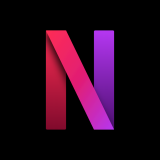
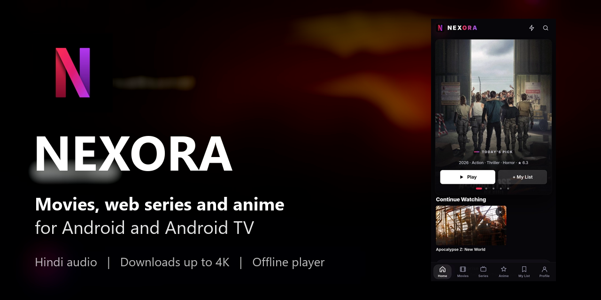
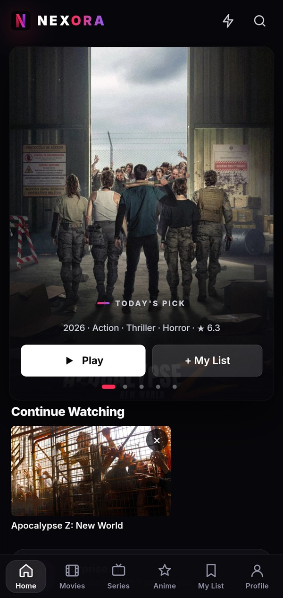
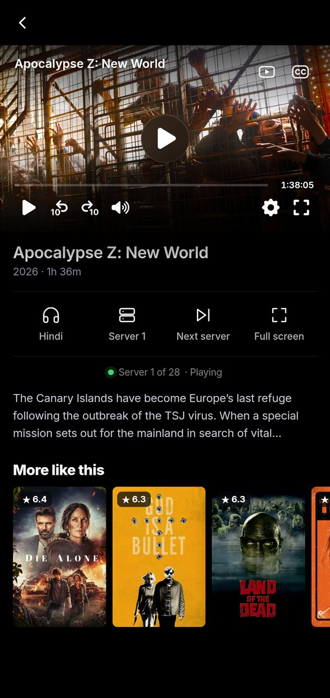
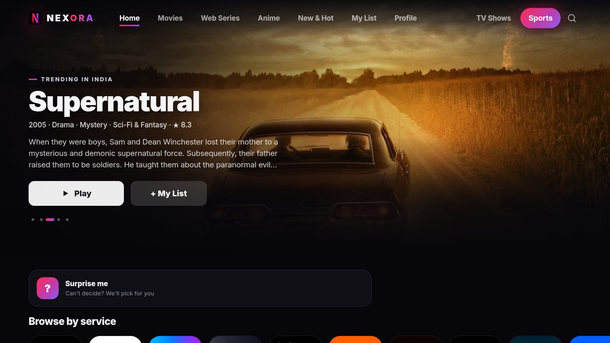

<div align="center">



# Nexora

**Movies, web series and anime in one Android app. Now on Android TV and Google TV too.**

Hindi audio, downloads up to 4K, a player built for phones, and no account to make.

[](https://github.com/Crylord-zx/NEXORA/releases/latest)
[](https://github.com/Crylord-zx/NEXORA/releases)


[**Download for Android**](https://github.com/Crylord-zx/NEXORA/releases/latest/download/nexora.apk) &nbsp;·&nbsp; [**Download for Android TV**](https://github.com/Crylord-zx/NEXORA/releases/latest/download/Nexora-TV.apk) &nbsp;·&nbsp; [**Website**](https://nexora-apk.vercel.app)



</div>

## In short

**Nexora is a free Android app for finding and watching movies, web series and anime.** It shows trending and new titles, plays them in a player made for phones (Picture-in-Picture, double-tap seek, subtitles, speed), lets you download a title in 480p, 720p, 1080p or 4K to watch offline, and has a separate version for Android TV and Google TV that works with the remote. There is nothing to sign up for.

| | Phone app | TV app |
|---|---|---|
| **Latest version** | 1.4.0 (build 12) | 1.0.0 (build 9) |
| **File** | `nexora.apk` | `Nexora-TV.apk` |
| **Size** | about 5.4 MB | about 1.6 MB |
| **Android** | 7.0 or newer | 7.0 or newer (Android TV, Google TV) |
| **Price** | Free | Free |
| **Account** | None | None |
| **Offline downloads** | Yes | No (streams only) |

## Download

| App | Download | SHA-256 |
|---|---|---|
| Nexora for Android | [nexora.apk](https://github.com/Crylord-zx/NEXORA/releases/latest/download/nexora.apk) | `0eaade3f0fa1a6cd6b4bb5e7327ab7704eae15cc8e577a36fd9d8fa75f0763a0` |
| Nexora for Android TV | [Nexora-TV.apk](https://github.com/Crylord-zx/NEXORA/releases/latest/download/Nexora-TV.apk) | `946d0813a7d6ec6fad771b01ff94809da8296d1c31d1053a4f82bee318f650c2` |

Every release is on the [Releases page](https://github.com/Crylord-zx/NEXORA/releases). See [Verify your download](#verify-your-download) to check the file you got.

## Features

- **One place for movies, web series and anime.** Home, Series, Anime, Downloads and My List, with Movies, TV Shows and Sports a tap away.
- **Hindi audio** when a title has it, with other languages and the original track as options.
- **Downloads.** Save a movie or an episode in 480p, 720p, 1080p or 4K (4K only when the title has it). Pause, resume, and watch offline from the Downloads tab.
- **A player made for phones.** Picture-in-Picture, double-tap to seek 10 seconds, swipes for volume, brightness and position, pinch to zoom, playback speed, audio and subtitle tracks, resume where you stopped, next episode.
- **4K when you ask for it.** A separate 4K button next to Play. If a title has no 4K file, Nexora says so and offers 1080p.
- **Android TV and Google TV app.** Made for the remote, with its own navigation sounds and picture modes.
- **Season picker, My List, Continue Watching, Surprise me.**
- **No sign-up, no ads of its own.** Pop-ups and redirects from third-party players are blocked.
- **Updates inside the app.** The app tells you when a new version is out.

## Screenshots

<p align="center">
  
  &nbsp;
  
</p>
<p align="center">
  
</p>

## Install

### On an Android phone

1. Download [`nexora.apk`](https://github.com/Crylord-zx/NEXORA/releases/latest/download/nexora.apk).
2. Open the file. If Android asks, allow your browser (or file manager) to install unknown apps. This is needed once because Nexora is shared as an APK.
3. Tap **Install**, then **Open**.

### On Android TV or Google TV

Pick one:

- **Downloader app (easiest).** Install the free *Downloader* app on your TV, open it and enter `nexora-apk.vercel.app/tv`. The file downloads to the TV. Allow Downloader to install apps when the TV asks, then tap **Install**.
- **From a USB drive.** Put [`Nexora-TV.apk`](https://github.com/Crylord-zx/NEXORA/releases/latest/download/Nexora-TV.apk) on a USB drive and open it on the TV with a file manager.
- **With adb.** `adb connect <tv-ip>:5555` then `adb install -r Nexora-TV.apk`.

## Update

- **Phone:** Nexora tells you when a new version is out every time you open it. You can also check from Profile. Tap **Update now**, then tap the "Download complete" notification and choose Install.
- **TV:** from TV build 9 on, open Profile and choose **Check for updates**. An older TV build needs this APK installed once by hand; after that it updates itself.

## Requirements

- Android 7.0 (API 24) or newer.
- An internet connection. Downloads need free space on the phone.
- For 4K playback, a device and screen that can decode 4K video.

## FAQ

### What is Nexora?
Nexora is a free Android app for browsing and watching movies, web series and anime, with Hindi audio, downloads up to 4K and a player made for phones. There is also an app for Android TV and Google TV.

### Is Nexora free?
Yes. No subscription and no account.

### Which Android version do I need?
Android 7.0 or newer, for both the phone app and the TV app.

### Does Nexora work on Android TV and Google TV?
Yes. Download `Nexora-TV.apk`. It is a separate app from the phone app, it works with the remote, and it streams only, so it needs very little storage.

### Is Nexora on the Google Play Store?
No. It is shared directly as an APK, so Android may ask you to allow the install once. Updates then come through the app.

### How do I update Nexora?
The phone app shows an update notice when a new version is out. On the TV app, open Profile and choose Check for updates. You can always get the newest APK from the [latest release](https://github.com/Crylord-zx/NEXORA/releases/latest).

### Can I download movies and episodes to watch offline?
Yes, in the phone app. Tap Download on a title, choose 480p, 720p, 1080p or 4K (4K only when the title has it), and watch it from the Downloads tab, including without internet. The TV app streams only.

### Does every title have Hindi audio?
No. It depends on the title. If a title has no Hindi track, Nexora offers the original audio and other languages it finds.

### Are there ads?
Nexora has no ads of its own. Videos come from third-party players, and some of them can show ads. Nexora blocks their pop-ups and redirects.

### Does it work on iPhone?
Not yet. Nexora is for Android.

### What does Nexora collect?
An anonymous device count, the app version, the country and what is played, so we know what people use. No names, no accounts, and no saved IP addresses.

### How do I know the APK is genuine?
Compare its SHA-256 with the table above and check its signing certificate. See below.

## Verify your download

**SHA-256 of the file.**

- Windows (PowerShell): `Get-FileHash nexora.apk -Algorithm SHA256`
- macOS or Linux: `sha256sum nexora.apk`

The result must match the table in [Download](#download).

**Signing certificate.** Every Nexora APK is signed with the same key. With the Android SDK's `apksigner`:

```
apksigner verify --print-certs nexora.apk
```

The certificate SHA-256 digest is:

```
403c5218eeddc9f23d628502a542ef60665af62ae33e3d66d5a7df82a3551028
```

An update only installs over Nexora if it carries this same signature.

## Privacy

Nexora has no accounts. The app counts devices anonymously (a scrambled id, version, country, what was played). It does not save names or IP addresses. Your watchlist, history and downloads stay on your device.

## Legal

- Nexora does **not** host, store or upload any video. Title information and pictures come from [TMDB](https://www.themoviedb.org). *This product uses the TMDB API but is not endorsed or certified by TMDB.*
- Videos are played from third-party players and files on the internet. Their owners are responsible for them.
- You are responsible for following the copyright and streaming laws where you live, and for only watching what you are allowed to watch.
- If you are a rights holder and have a concern, [open an issue](https://github.com/Crylord-zx/NEXORA/issues/new) titled "Rights notice" and it will be looked at.

## Links

- Website: <https://nexora-apk.vercel.app>
- Releases and changelog: <https://github.com/Crylord-zx/NEXORA/releases>
- Latest phone APK: <https://github.com/Crylord-zx/NEXORA/releases/latest/download/nexora.apk>
- Latest TV APK: <https://github.com/Crylord-zx/NEXORA/releases/latest/download/Nexora-TV.apk>
- Report a problem or ask for something: [Issues](https://github.com/Crylord-zx/NEXORA/issues)
